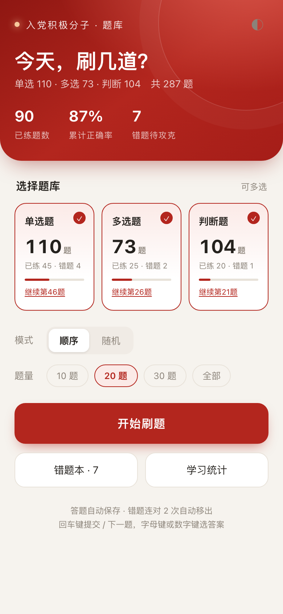
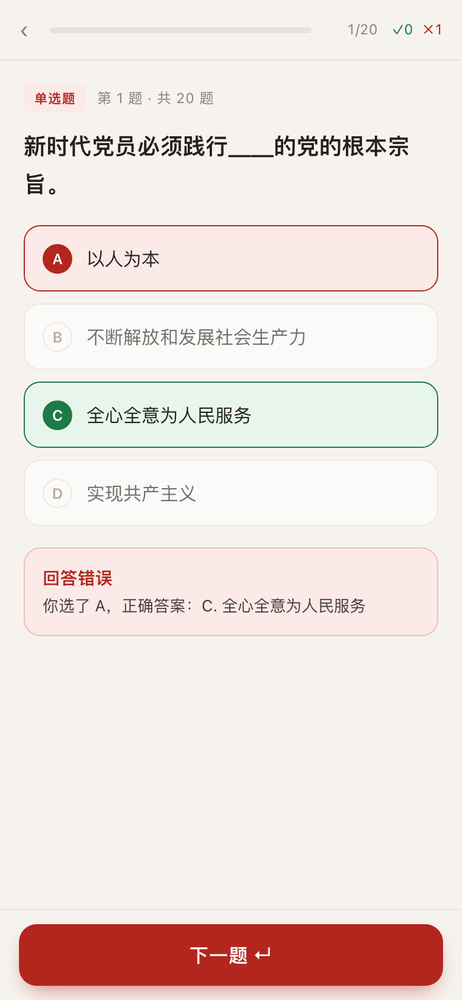
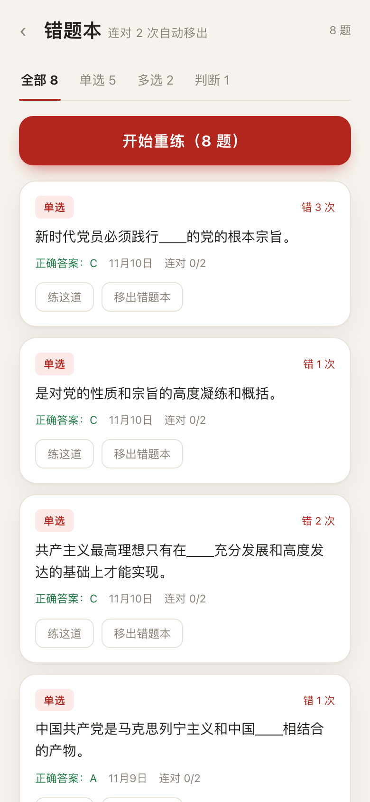
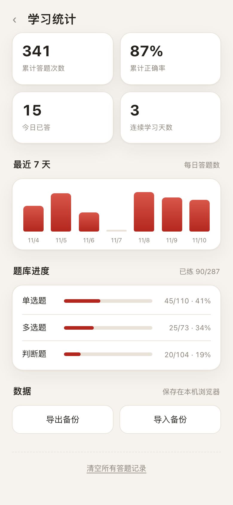
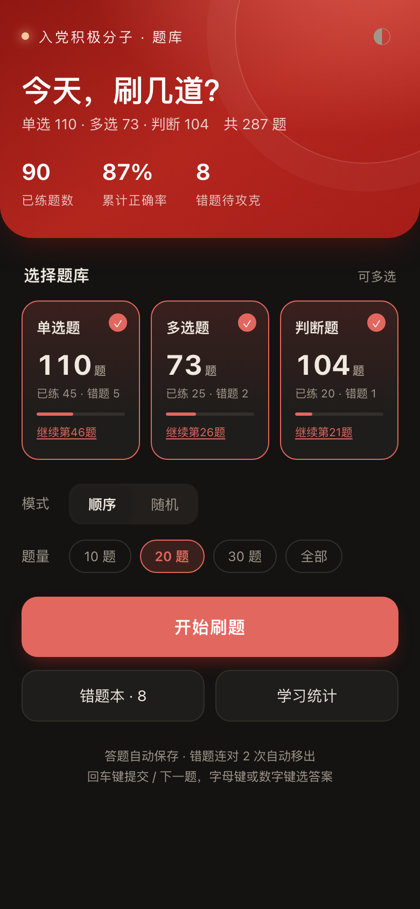
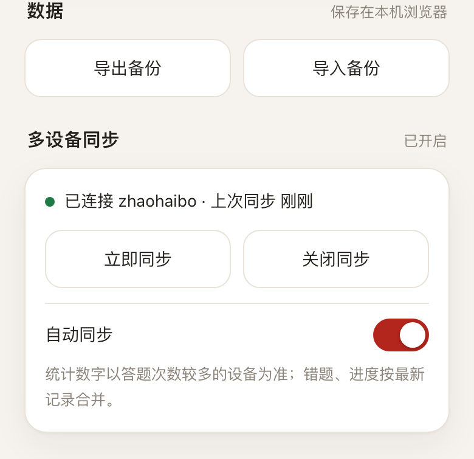

# 入党积极分子刷题

一个**单文件、离线可用**的入党积极分子题库刷题网页：287 道单选 / 多选 / 判断题，自动判题、自动收集错题、连续答对自动移出错题本，并记录学习统计。

无需安装、无需联网、无需后端，双击 `index.html` 就能刷；手机浏览器同样适用。



## 功能

- **三个题库自由组合**：单选 110 题、多选 73 题、判断 104 题，可全选或只练某一类。
- **顺序 / 随机**：顺序模式适合系统过一遍，随机模式适合自测。
- **每组题量可选**：10 / 20 / 30 题或全部，刷完自动结算。
- **即时判题**：单选、判断点选即出结果；多选选完提交。答错立刻显示正确答案与你的选择。
- **错题本**：答错自动收录，支持按题型筛选、单题重练、整本重练；**连续答对 2 次自动移出**，不用手动清理。
- **学习统计**：累计答题次数、正确率、今日答题、连续学习天数、最近 7 天柱状图、各题库进度。
- **进度自动保存**：记录存在浏览器本地（localStorage），关掉再开可接着上次的题继续。
- **备份**：统计页可导出 / 导入 JSON 备份，换浏览器或清缓存也不怕。
- **多设备同步（可选）**：手机和电脑刷同一份题，进度接着走；数据写进你自己的私有 Gist，不需要服务器。
- **细节**：深色模式、手机适配、键盘答题（A–E / 1–9 选项、回车下一题、Esc 退出）。

| 答题 | 错题本 |
| --- | --- |
|  |  |

| 学习统计 | 深色模式 |
| --- | --- |
|  |  |

## 题库说明

| 题库 | 题量 | 说明 |
| --- | --- | --- |
| 单选题 | 110 | 原始文档 111 题，其中 1 题完全重复，已合并 |
| 多选题 | 73 | 选项字母重复的题目已按顺序校正为 A/B/C/D/E |
| 判断题 | 104 | 答案“对 / 错”已从题干末尾拆出，单独保存 |

题目与答案整理自公开的入党积极分子学习资料，**仅供学习自测使用**；如与本单位最新教材或考试要求不一致，以官方为准。

## 使用

### 直接打开

下载 `index.html`，双击用浏览器打开即可。

### 手机

把 `index.html` 发到微信 / QQ，用手机浏览器打开；或部署到静态托管后访问链接。

### 部署到 GitHub Pages / Gitee Pages

仓库根目录已经是可直接部署的静态站点：

1. GitHub：Settings → Pages → Source 选 `Deploy from a branch`，分支 `main`、目录 `/ (root)`。
2. Gitee：服务 → Gitee Pages → 部署分支 `main`。

部署后访问 `https://<用户名>.github.io/<仓库名>/` 即可，手机也能直接刷。

### 多设备同步（可选）

手机和电脑各刷各的、进度不互通？开启同步后，两边接续同一份进度。



1. 打开 [GitHub Token 创建页](https://github.com/settings/tokens/new?scopes=gist&description=rudang-quiz-sync)（已预选 `gist` 权限），生成后复制 `ghp_...`。
2. 在刷题页进入「学习统计 → 多设备同步 → 开启多设备同步」，粘贴令牌，点「连接并同步」。第一次会自动创建一个私有 Gist（描述 `rudang-quiz-progress-v1`）。
3. 另一台设备打开同一个网页，用**同一个令牌**连接即可拉取进度；之后每次答题 4 秒后自动同步。

合并规则：每题的记录按时间取新，刷过的题取并集，统计次数取较大的那台设备。令牌只保存在该设备的浏览器里，不会写进备份文件，也不会出现在网页代码中。

## 数据与隐私

- 默认所有答题记录只保存在当前浏览器的 `localStorage`（键名 `rds.quiz.v1`），不上传任何服务器。
- 开启「多设备同步」后，答题进度会写入你 GitHub 账号下一个**私有 Gist**；同步令牌只存在本机 `localStorage`（键名 `rds.sync.v1`），不随备份导出。
- 清理浏览器数据、换浏览器或使用无痕模式会丢失进度；重要记录请在「学习统计 → 导出备份」保存。
- 导入备份会覆盖当前记录，导入前建议先导出一次。

## 本地开发

题库数据、模板与构建脚本在 `_build/` 中：

```
_build/
├── app_template.html   # 页面模板（样式 + 逻辑，__DATA__ 占位）
├── data.json           # 解析后的题库数据
├── build.py            # 重新生成 index.html
└── deploy.py           # 构建 + 发布到 GitHub Pages
```

修改模板或数据后执行：

```bash
python3 _build/build.py
```

会生成 `index.html`（单文件，内联全部数据与样式）。

## 发布更新

```bash
python3 _build/deploy.py
```

一条命令完成：重建 → 与远端逐个文件比对 → 只提交变化 → 等 Pages 刷新为同一份文件。
脚本走 `api.github.com`，不依赖 `git push`。令牌从环境变量 `GH_TOKEN` 或 macOS 钥匙串
（service `rudang-quiz-deploy`）读取，不进代码、不进仓库。

## 目录结构

```
.
├── index.html          # 单文件应用（打开即用）
├── screenshots/        # README 截图
├── _build/             # 题库数据、模板、构建脚本
├── README.md
└── LICENSE
```

## License

[MIT](LICENSE)
